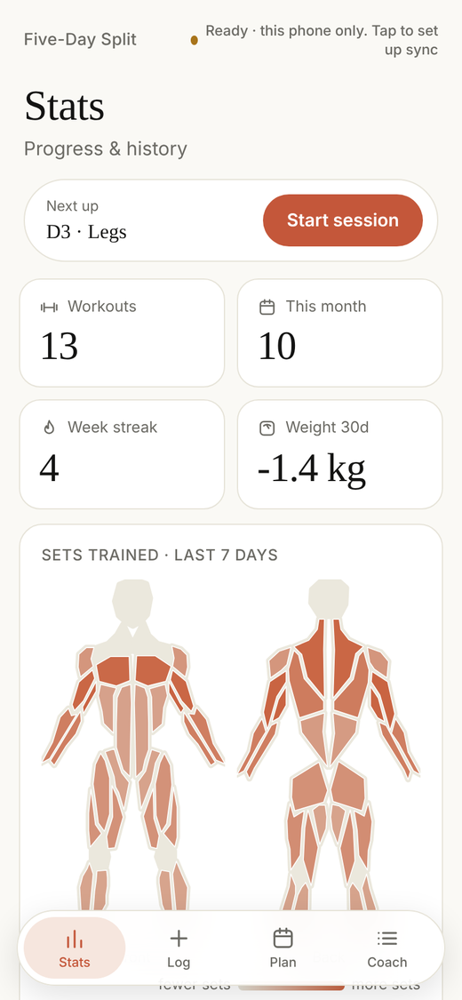
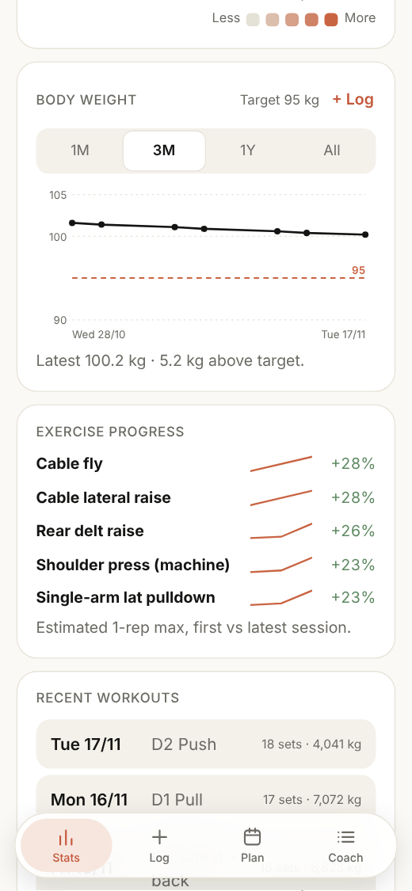
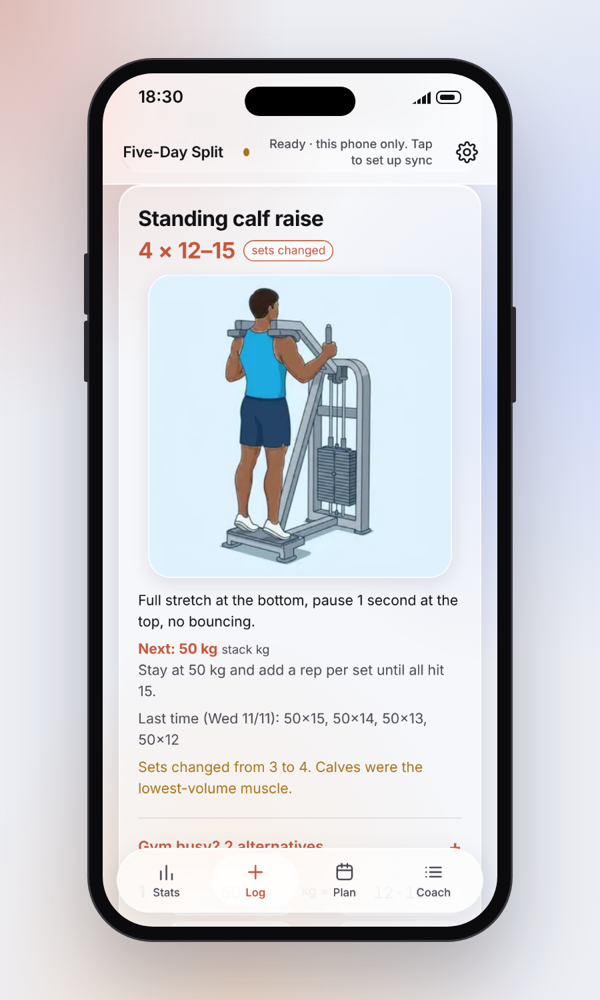
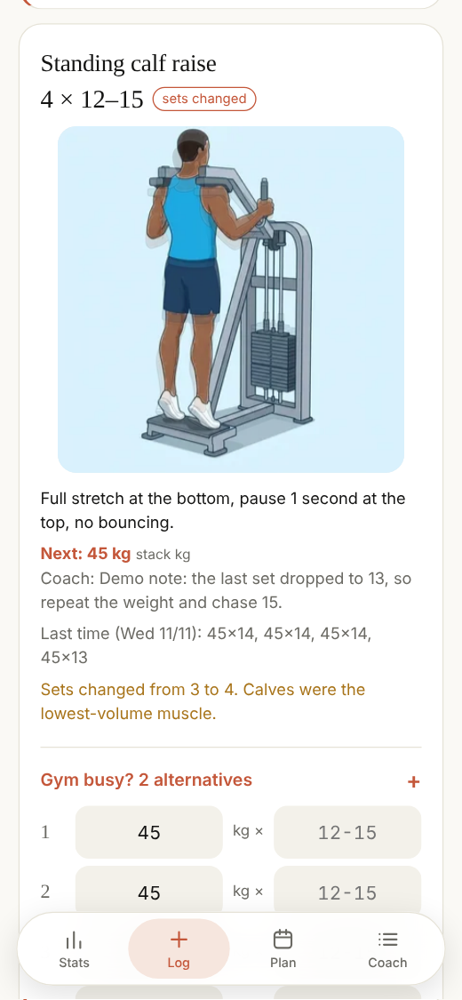
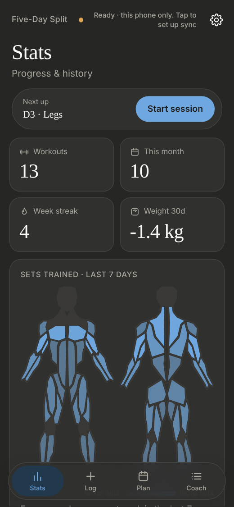
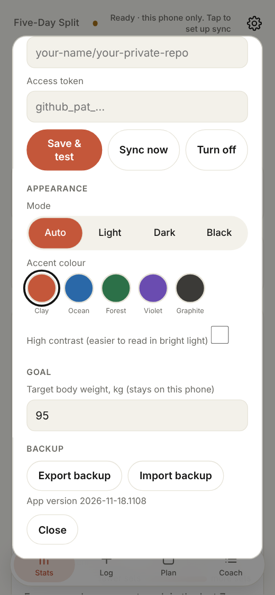
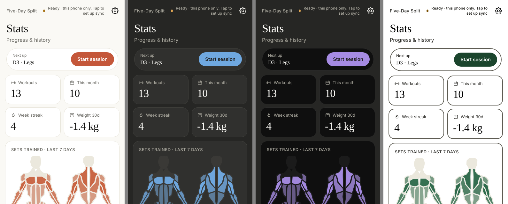

# Split

An offline-first workout tracker for a five-day split. It installs on an iPhone home screen, saves every set on the phone the moment you type it, and then copies your logs to a private GitHub repo so a coach (human or Claude) can read them.

> Screenshots use made-up demo data.

| Stats | Activity | Log |
|---|---|---|
|  |  |  |

| Exercise card | Dark mode | Settings |
|---|---|---|
|  |  |  |



## What it does

- **Log:** pick the day (D1 Pull, D2 Push, D3 Legs, D4 Arms and delts, D5 Chest and back), enter weight and reps per set. Every change autosaves on the phone after half a second.
- **Suggested weights:** double progression. When every set reaches the top of the rep range, the next session suggests the next step up.
- **Gym busy?** Each exercise lists alternatives (cable, machine, dumbbell, band). Logging one keeps its history separate from the original lift.
- **Stats:** muscles trained in the last 7 days on a body map, activity calendar, body weight trend, strength trends and recent workouts.
- **Offline:** works with no signal. Logs wait on the phone and upload when a connection returns.
- **Coach notes:** if the data repo contains `coach/YYYY-MM-DD.json`, the Log tab shows its summary for that date and uses its per-exercise weights as the suggestion.
- **Themes:** Auto, Light, Dark or true-black (OLED) mode, five accent colours (Clay, Ocean, Forest, Violet, Graphite) and a high-contrast option for bright gyms. Set in Settings and saved on the phone.

## Install on an iPhone

1. Open the app's GitHub Pages address in Safari.
2. Tap Share, then **Add to Home Screen**.
3. Open it from the new icon. Tap the status text at the top to open Settings.

## Turn on cloud sync (optional)

Your workouts always save on the phone first. Sync adds a second copy in a private GitHub repo.

1. Create a **private** repo for the logs, for example `split-data`.
2. On GitHub: Settings → Developer settings → Personal access tokens → Fine-grained tokens → Generate new token.
   - Repository access: only that private repo.
   - Permissions: Contents → Read and write.
   - Expiry: 90 days.
3. In the app: tap the status text, enter `your-name/your-repo` and the token, then **Save & test**.

The app refuses to sync to a public repo. The token is stored only in the phone's browser storage, and the app's content security policy lets it talk to `api.github.com` and nothing else.

### Data layout in the private repo

```
sessions/YYYY-MM-DD.json   one file per workout, written by the app
coach/YYYY-MM-DD.json      optional notes for that day, read by the app
```

A session looks like this:

```json
{
  "date": "2026-11-18",
  "day": "D3",
  "bw": 98.4,
  "notes": "free text",
  "savedAt": "2026-11-18T18:30:00.000Z",
  "entries": {
    "d3-lp": { "sets": [{ "kg": 80, "reps": 12 }] },
    "d3-le": { "alt": "sle", "sets": [{ "kg": 20, "reps": 12 }] }
  }
}
```

`alt` means an alternative exercise was used instead of the planned one.

A coach file looks like this:

```json
{
  "date": "2026-11-18",
  "day": "D3",
  "summary": "Plain text shown on the Log tab.",
  "overrides": { "d3-lp": { "kg": 85, "note": "Last time 3x12 at 80 kg, add 5 kg" } }
}
```

## Backup

Settings has **Export backup** (a JSON file through the iOS share sheet) and **Import backup**. Importing keeps the newer version of each day.

## Develop

The app is built from `src/`:

```
python3 src/build.py
```

This writes `index.html`, `split.js`, `theme.js`, `sw.js` and `manifest.webmanifest` at the repo root. Scripts live in their own files, not inline, so the content security policy can block inline script.

Tests run the built app in a headless browser against a fake GitHub API (needs Node 18+ and Playwright with Chromium):

```
npm i --no-save playwright && npx playwright install chromium
python3 src/build.py && node --test tests/app.test.js
``` Commit and push, and GitHub Pages redeploys in a minute or two. The service worker serves the cached copy when offline and the fresh copy when online.

Plan data (exercises, sets, rep ranges, start weights) lives in `src/data.js`, and the alternatives in `src/alts.js`.

## Privacy

This repo holds the app only. Workout logs, body weight and notes live on the phone and in the private data repo, never here.

## Licence and credits

Code: MIT, see `LICENSE`. Exercise illustrations and body-map polygons come from third parties and are not covered by the MIT licence: see `NOTICE.md`. Exercise data by [RepDB](https://repdb.co).
