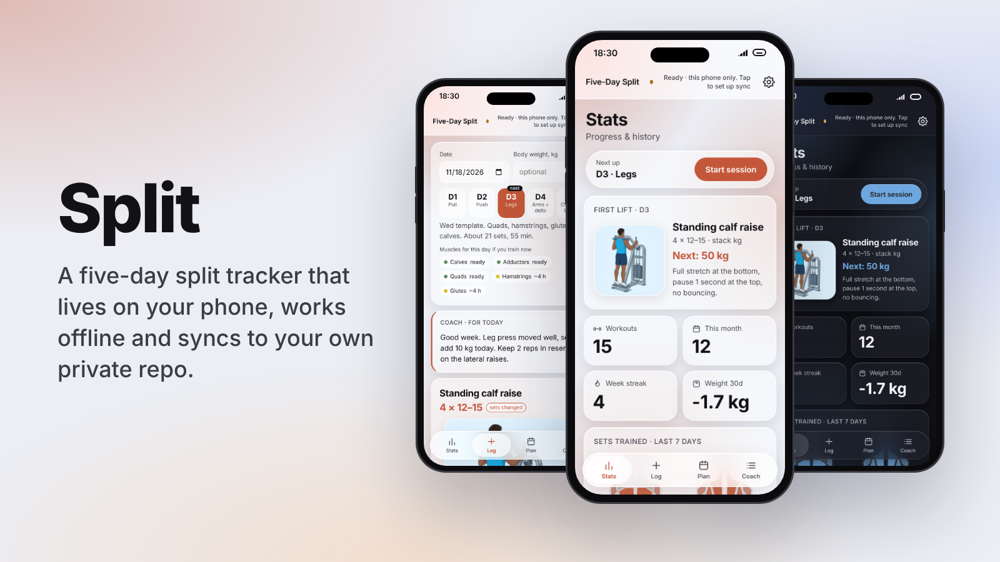
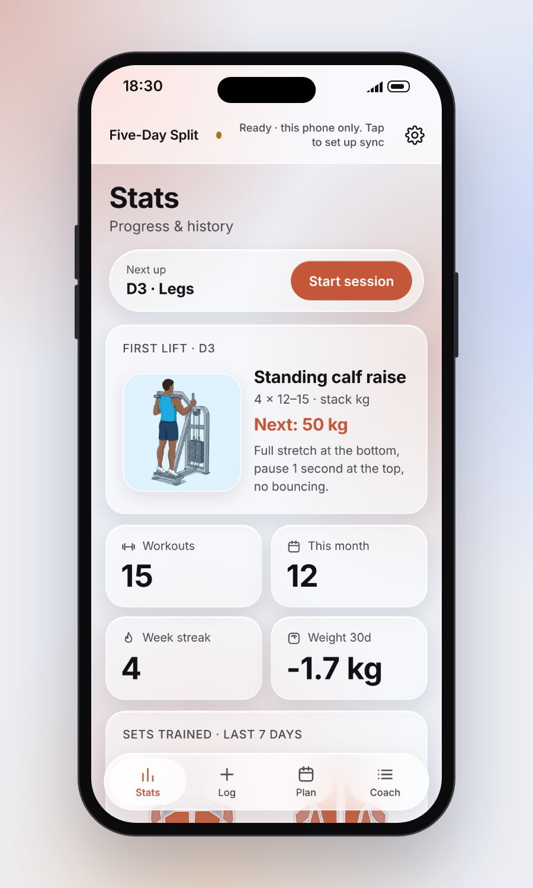
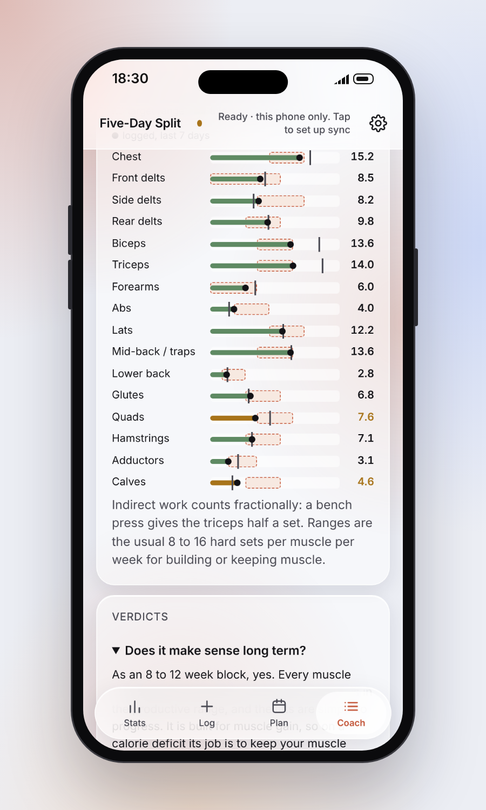
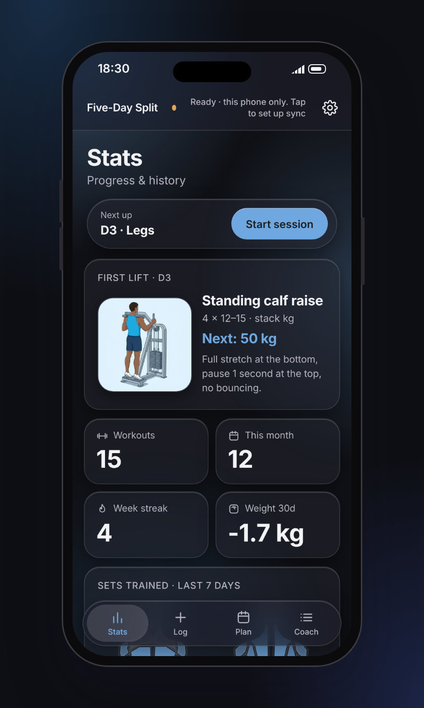

<p align="center">
  
</p>

<h1 align="center">Split</h1>

<p align="center">
  <b>A five-day split workout tracker for your phone.</b><br>
  Log every set offline, get the next weight to lift, and keep a private copy of your logs on GitHub that you, or a coach, can read.
</p>

<p align="center">
  <a href="#install-on-an-iphone">Install</a> ·
  <a href="#turn-on-cloud-sync-optional">Sync</a> ·
  <a href="#develop">Develop</a> ·
  <a href="#privacy">Privacy</a>
</p>

> The screens below use made-up demo data.

<table>
<tr>
<td width="44%"></td>
<td>

### Log a set in seconds

Pick the day (D1 Pull, D2 Push, D3 Legs, D4 Arms and delts, D5 Chest and back) and enter weight and reps. Every change saves on the phone half a second after you type, with or without signal.

Each exercise shows a short animation of its start and end position, the form cue, and what you lifted last time. With Reduce Motion turned on, the animation holds still and a tap switches between the two positions.

**Gym busy?** Every lift lists alternatives (cable, machine, dumbbell, band). Logging one keeps its history separate from the original.

</td>
</tr>
<tr>
<td>

### The next weight, worked out for you

Suggested weights use double progression. When every set reaches the top of the rep range, the next session suggests the next step up. Until then, it tells you to stay and add a rep.

The Stats tab opens on your next session, with its first lift and target weight ready.

</td>
<td width="44%"></td>
</tr>
<tr>
<td width="44%"></td>
<td>

### See what you actually trained

- A body map of the muscles worked in the last 7 days
- An activity calendar for the week, the calendar month or longer ranges
- A body weight trend and estimated one-rep-max progress per lift
- Weekly hard sets per muscle, set against the usual target ranges

</td>
</tr>
<tr>
<td>

### A coach in the loop

If your data repo has `coach/YYYY-MM-DD.json`, the Log tab shows its note for that day and uses its per-exercise weights as the suggestion. A human coach or Claude can write those files after reading your sessions.

### Looks right in the gym

Liquid Glass styling in Auto, Light, Dark or Black mode, with five accent colours. The background is a soft gradient in whichever accent you pick. High contrast turns the glass solid for bright gyms.

</td>
<td width="44%"></td>
</tr>
</table>

## Install on an iPhone

1. Open the app's GitHub Pages address in Safari.
2. Tap Share, then **Add to Home Screen**.
3. Open it from the new icon. Tap the status text at the top to open Settings.

## Turn on cloud sync (optional)

Your workouts always save on the phone first. Sync adds a second copy in a private GitHub repo.

1. Create a **private** repo for the logs, for example `split-data`.
2. On GitHub: Settings → Developer settings → Personal access tokens → Fine-grained tokens → Generate new token.
   - Repository access: only that private repo.
   - Permissions: Contents → Read and write.
   - Expiry: 90 days.
3. In the app: tap the status text, enter `your-name/your-repo` and the token, then **Save & test**.

The app refuses to sync to a public repo. The token is stored only in the phone's browser storage, and the app's content security policy lets it talk to `api.github.com` and nothing else.

### Data layout in the private repo

```
sessions/YYYY-MM-DD.json   one file per workout, written by the app
coach/YYYY-MM-DD.json      optional notes for that day, read by the app
```

A session looks like this:

```json
{
  "date": "2026-11-18",
  "day": "D3",
  "bw": 98.4,
  "notes": "free text",
  "savedAt": "2026-11-18T18:30:00.000Z",
  "entries": {
    "d3-lp": { "sets": [{ "kg": 80, "reps": 12 }] },
    "d3-le": { "alt": "sle", "sets": [{ "kg": 20, "reps": 12 }] }
  }
}
```

`alt` means an alternative exercise was used instead of the planned one.

A coach file looks like this:

```json
{
  "date": "2026-11-18",
  "day": "D3",
  "summary": "Plain text shown on the Log tab.",
  "overrides": { "d3-lp": { "kg": 85, "note": "Last time 3x12 at 80 kg, add 5 kg" } }
}
```

## Backup

Settings has **Export backup** (a JSON file through the iOS share sheet) and **Import backup**. Importing keeps the newer version of each day.

## Develop

The app is built from `src/`:

```
python3 src/build.py
```

This writes `index.html`, `split.js`, `theme.js`, `sw.js` and `manifest.webmanifest` at the repo root. Scripts live in their own files, not inline, so the content security policy can block inline script.

Tests run the built app in a headless browser against a fake GitHub API (needs Node 18+ and Playwright with Chromium):

```
npm i --no-save playwright && npx playwright install chromium
python3 src/build.py && node --test tests/app.test.js
```

The README images are rendered from the built app with made-up demo data, so they can be redrawn after any change:

```
python3 src/build.py && node tools/readme-shots.js
```

Commit and push, and GitHub Pages redeploys in a minute or two. The service worker serves the cached copy when offline and the fresh copy when online.

Plan data (exercises, sets, rep ranges, start weights) lives in `src/data.js`, and the alternatives in `src/alts.js`.

## Privacy

This repo holds the app only. Workout logs, body weight and notes live on the phone and in the private data repo, never here.

## Licence and credits

Code: MIT, see `LICENSE`. Exercise illustrations and body-map polygons come from third parties and are not covered by the MIT licence: see `NOTICE.md`. Exercise data by [RepDB](https://repdb.co).
